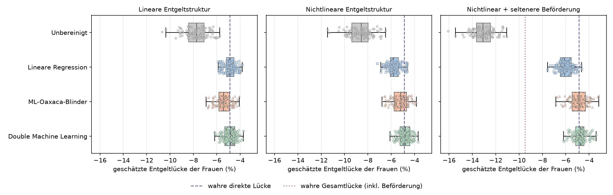
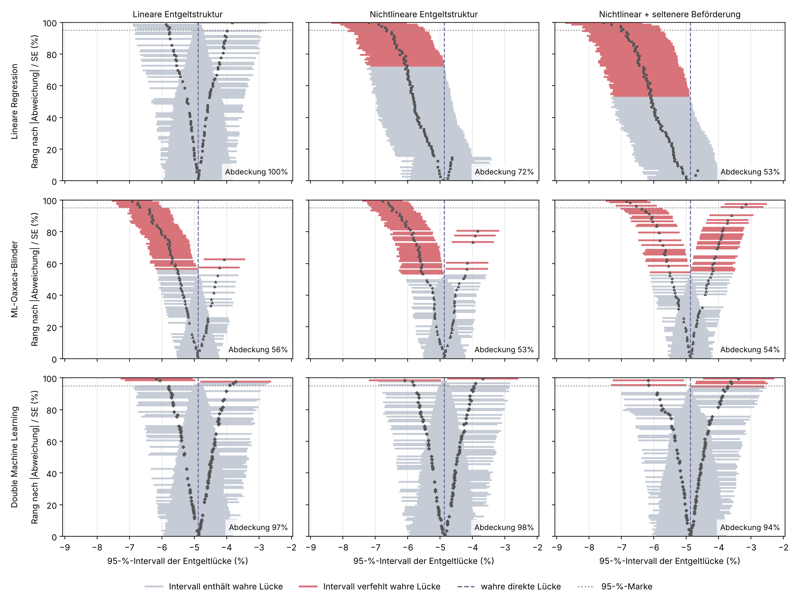

# Bereinigte Entgeltlücke mit Machine Learning


Die EU-Entgelttransparenzrichtlinie (EU) 2023/970 verlangt von Arbeitgebern, Entgeltunterschiede
zwischen Frauen und Männern zu berichten. Bleibt in einer Gruppe gleicher oder gleichwertiger Arbeit
ein Unterschied von 5 % oder mehr, der sich nicht durch objektive, geschlechtsneutrale Kriterien
erklären lässt, ist eine gemeinsame Entgeltbewertung fällig. Die Kernfrage ist also: **Wie groß ist
die Entgeltlücke bei gleichen objektiven Merkmalen?**

Dieses Projekt vergleicht, wie gut klassische und ML-gestützte Methoden diese bereinigte Lücke
treffen. Weil echte Personaldaten sensibel sind und die wahre Lücke nie bekannt ist, arbeitet es mit
**synthetischen Daten mit eingebauter, bekannter Lücke**. So lässt sich messen, wie weit jede
Methode danebenliegt.

## Kernergebnis

Bei nichtlinearer Entgeltstruktur überschätzt die übliche lineare Regression die Lücke um knapp
einen Prozentpunkt, und ihr 95-%-Intervall enthält den wahren Wert nur in 72 % der Fälle.
**Double Machine Learning trifft die Lücke in allen Szenarien bis auf 0,1 Prozentpunkte** und hält
die nominelle Intervallabdeckung von 95 % ein. Keine Methode erkennt aber Benachteiligung, die über die
herausgerechneten Merkmale selbst wirkt (hier: seltenere Beförderung).



*Jeder Punkt ist die Schätzung aus einem simulierten Datensatz. Die Box umfasst die mittleren 50 %
der Schätzungen, der Strich darin ist der Median, die Fehlerbalken reichen bis zur äußersten
Schätzung innerhalb des 1,5-Fachen der Boxbreite. Die Abbildung zeigt Verzerrung und Streuung,
nicht die Konfidenzintervalle.*

| Szenario | Methode | Schätzung | Verzerrung | Abdeckung 95-%-Intervall |
|---|---|---:|---:|---:|
| linear | Lineare Regression | −4,9 % | 0,0 pp | 100 % |
| | ML-Oaxaca-Blinder | −5,4 % | −0,5 pp | 56 % |
| | Double Machine Learning | −4,9 % | 0,0 pp | 97 % |
| nichtlinear | Lineare Regression | −5,8 % | −0,9 pp | 72 % |
| | ML-Oaxaca-Blinder | −5,3 % | −0,4 pp | 53 % |
| | Double Machine Learning | −4,8 % | 0,0 pp | 98 % |
| + seltenere Beförderung | Lineare Regression | −6,0 % | −1,1 pp | 53 % |
| | ML-Oaxaca-Blinder | −4,9 % | 0,0 pp | 54 % |
| | Double Machine Learning | −4,8 % | +0,1 pp | 94 % |

Wahre direkte Lücke −4,9 %; im dritten Szenario beträgt die Gesamtlücke einschließlich seltenerer
Beförderung −9,5 %. Unbereinigt liegen die Werte bei −7,7 %, −8,7 % und −13,1 %. 3000 Beschäftigte
je simuliertem Unternehmen, 100 Wiederholungen je Szenario; die Abdeckungswerte sind damit auf etwa
±4 Prozentpunkte genau. Die RMSE von Double Machine Learning liegt in allen Szenarien bei
0,6 Log-Punkten × 100, die der linearen Regression steigt von 0,5 auf 1,4.

### Stimmen die Konfidenzintervalle?



*Zip-Plot (Morris, White & Crowther, 2019): jede Linie ist das 95-%-Intervall aus einem simulierten
Datensatz, der Punkt die Schätzung. Von unten nach oben sind die Intervalle nach dem Abstand der
Schätzung zur wahren Lücke sortiert, gemessen in Standardfehlern. Rot sind Intervalle, die die wahre
Lücke verfehlen. Bei korrekten Intervallen liegt Rot nur oberhalb der 95-%-Marke, gleichmäßig auf
beiden Seiten.*

Die beiden schwächeren Methoden scheitern aus verschiedenen Gründen:

- **Lineare Regression:** Bei nichtlinearer Entgeltstruktur sind alle Intervalle nach links
  verschoben, und alle verfehlenden Intervalle liegen links der wahren Lücke. Die Intervallbreite
  stimmt, die Schätzung ist verzerrt, weil die Modellannahme nicht passt.
- **ML-Oaxaca-Blinder:** Rot beginnt schon bei etwa 55 %, weil die Intervalle etwa halb so breit
  sind, wie die tatsächliche Streuung verlangt. In den ersten beiden Szenarien kommt eine leichte
  Verschiebung nach links hinzu; im dritten liegt die Schätzung im Mittel richtig, und Rot verteilt
  sich auf beide Seiten.
- **Double Machine Learning:** Rot erscheint erst oberhalb der 95-%-Marke und auf beiden Seiten.

## Vorgehen

1. **Synthetische Daten** (`paygap/generate.py`): Jobfamilie, Standort, Alter, Berufserfahrung,
   Teilzeit, Entgeltstufe und Geschlecht; Zielgröße ist das logarithmierte Stundenentgelt. Frauen
   arbeiten häufiger in Teilzeit, in anderen Jobfamilien und haben im Mittel mehr
   Erwerbsunterbrechungen. Diese Unterschiede sind erklärt. Zusätzlich verdienen Frauen bei gleichen
   Merkmalen 5 Log-Punkte (≈ 4,9 %) weniger; das ist die direkte Lücke. Drei Szenarien:
   - **linear:** Entgelt hängt linear und additiv von den Merkmalen ab.
   - **nichtlinear:** Erfahrung wirkt sättigend, Stufe 4 bringt einen Sprung, der Standortzuschlag
     hängt von der Jobfamilie ab, der Teilzeitabschlag wächst mit der Entgeltstufe.
   - **seltenere Beförderung:** wie nichtlinear, zusätzlich erreichen Frauen bei gleicher
     Qualifikation seltener höhere Entgeltstufen.
2. **Schätzer** (`paygap/methods.py`):
   - **Unbereinigt:** Differenz der Mittelwerte.
   - **Lineare Regression:** Stundenentgelt auf Geschlecht und alle Merkmale, robuste
     Standardfehler (HC1). Der übliche Ansatz in Entgeltanalysen.
   - **ML-Oaxaca-Blinder:** Gradient Boosting lernt die Entgeltstruktur der Männer und sagt für
     jede Frau vorher, was ein Mann mit ihren Merkmalen verdienen würde. Die mittlere Abweichung
     ist der unerklärte Teil.
   - **Double Machine Learning:** Zwei Gradient-Boosting-Modelle sagen Entgelt und Geschlecht aus
     den Merkmalen vorher (mit 5-fachem Cross-Fitting). Die Lücke ergibt sich aus der Regression der
     Restgrößen aufeinander und hat ein gültiges Konfidenzintervall, obwohl die Modelle flexibel sind
     (Chernozhukov et al., 2018). Die Grundidee ist in [docs/methodik.md](docs/methodik.md) erklärt.
3. **Simulationsstudie** (`paygap/study.py`): je Szenario viele unabhängige Datensätze; gemessen
   werden Verzerrung, RMSE und wie oft das 95-%-Intervall die wahre Lücke enthält.
4. **Überlappungsdiagnose:** Das Geschlechtsmodell aus Double Machine Learning zeigt, wo es kaum
   vergleichbare Personen des anderen Geschlechts gibt (vorhergesagter Frauenanteil unter 5 % oder
   über 95 %). In den simulierten Daten betrifft das im Mittel 10 % der Beschäftigten, mit
   seltenerer Beförderung 15 %. Es sind vor allem Teilzeitkräfte in Forschung, Verwaltung und
   Vertrieb (fast nur Frauen) sowie Vollzeitkräfte in der Produktion (fast nur Männer).

## Einordnung

- **Warum ML hier hilft:** Die lineare Regression unterstellt eine Entgeltstruktur. Stimmt sie
  nicht und sind Frauen und Männer ungleich über die Merkmale verteilt, landet der Modellfehler in
  der Lücke. Flexible Modelle vermeiden das.
- **Warum nicht einfach ML-Oaxaca-Blinder:** Das Gradient-Boosting-Modell glättet in Bereichen mit
  wenigen Männern (Regularisierung) und ist dadurch leicht verzerrt. Sein Intervall berücksichtigt
  zudem nur das Rauschen der Frauen, nicht die Unsicherheit des Modells, und ist daher zu schmal.
  Double Machine Learning korrigiert beides.
- **Was keine Methode löst:** Wer die Entgeltstufe herausrechnet, obwohl Frauen seltener befördert
  werden, rechnet einen Teil der Benachteiligung weg. Welche Merkmale als objektiv gelten, ist eine
  inhaltliche Entscheidung, keine statistische. Eine bereinigte Lücke ist außerdem kein Beweis für
  Diskriminierung und keine Entlastung, sondern ein Hinweis, wo genauer hingesehen werden sollte.

## Grenzen

- Synthetische Daten: Die Ergebnisse zeigen, wie die Methoden unter den gewählten Annahmen
  arbeiten, nicht wie groß die Lücke in einem echten Unternehmen ist.
- Bisher wird nur eine Gesamtlücke geschätzt; die Richtlinie verlangt Auswertungen je Gruppe
  gleichwertiger Arbeit.

## Ausführen

```bash
python -m venv .venv && source .venv/bin/activate
pip install -e ".[dev]"

python scripts/analyze.py --scenario nonlinear --seed 1     # ein Datensatz, alle Schätzer
python scripts/run_study.py                                 # Studie, 100 Wiederholungen (~15 min)
python scripts/run_study.py --reps 5 --out-dir results/test # schneller Test
pytest -q
```

`analyze.py --csv datei.csv` analysiert eigene Daten mit den Spalten `female`, `job`, `location`,
`age`, `experience`, `parttime`, `level` und `log_wage`.

## Struktur

```
configs/default.yaml     Studienparameter und Modellparameter
src/paygap/generate.py   synthetische Personaldaten mit bekannter Lücke
src/paygap/methods.py    Schätzer: unbereinigt, OLS, ML-Oaxaca-Blinder, Double ML
src/paygap/study.py      Simulationsstudie und Kennzahlen
src/paygap/plots.py      Abbildungen (Verteilung der Schätzungen, Zip-Plot)
scripts/                 analyze.py (ein Datensatz), run_study.py (Studie)
tests/                   pytest
docs/methodik.md         wahre Lücke und Grundidee von Double Machine Learning
docs/figures, results    Abbildung und Kennzahlen des letzten Studienlaufs
```

## Nächste Schritte

- Lücke je Gruppe gleichwertiger Arbeit mit Bootstrap-Intervallen und der 5-%-Schwelle.
- Datenschutz: Mindestgruppengrößen oder Differential Privacy für kleine Gruppen.
- Auffällige Einzelfälle per Quantilregression.
